# MercaFamily

Lista de la compra familiar compartida en tiempo real, con el catálogo y los precios de Mercadona actualizados solos cada semana.

**App:** https://carlosdarko.github.io/mercafamily/

<p>
  
  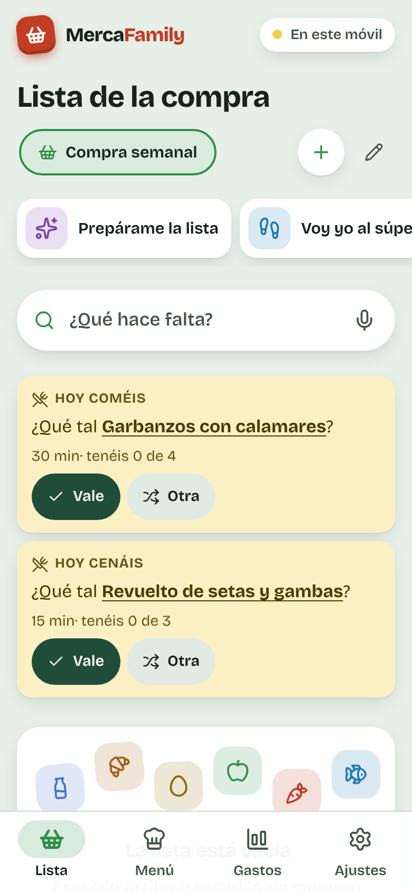
  
  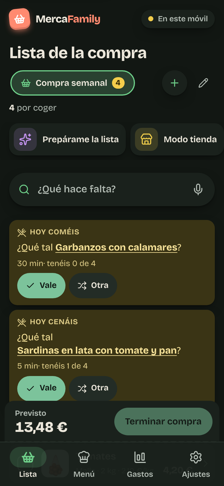
  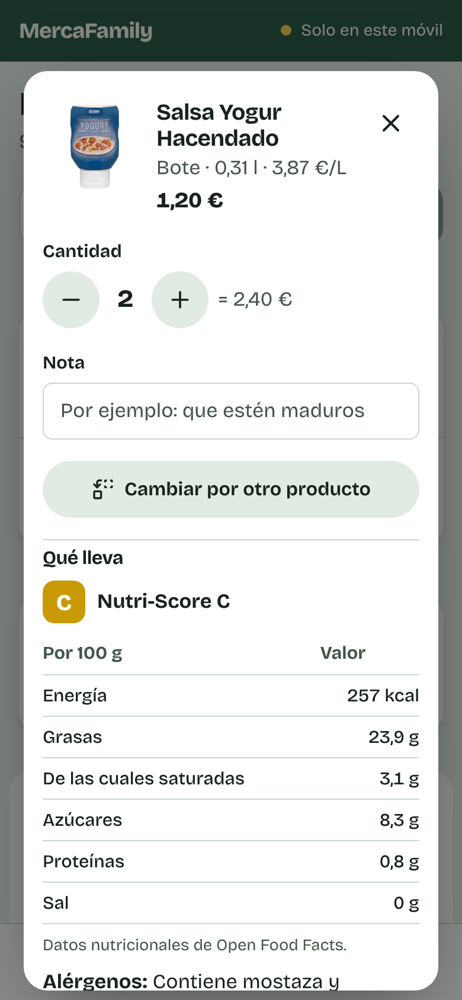
  
  
  
  
  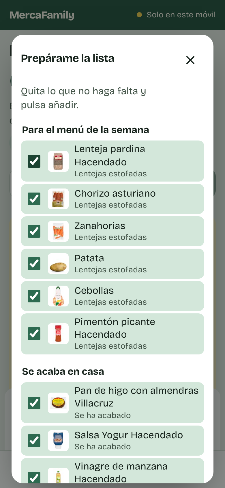
  
  
  
  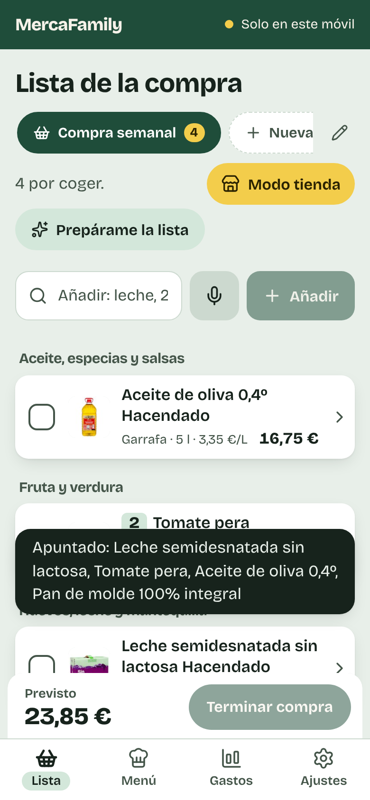
  
  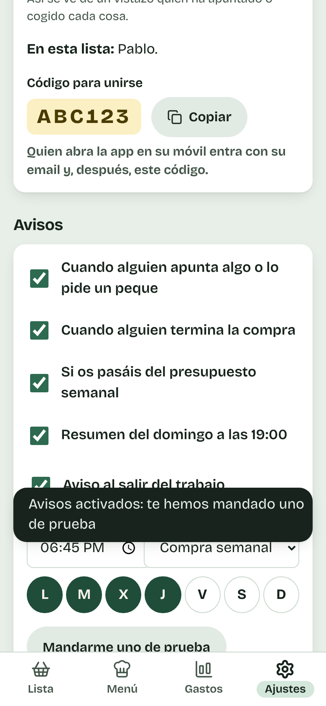
  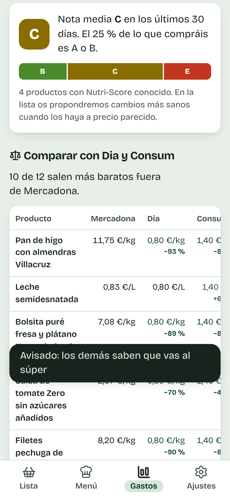
  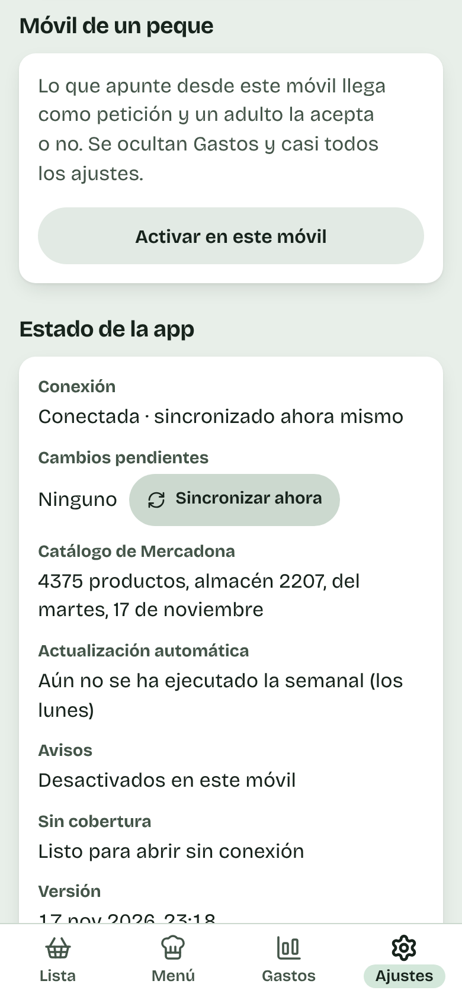
  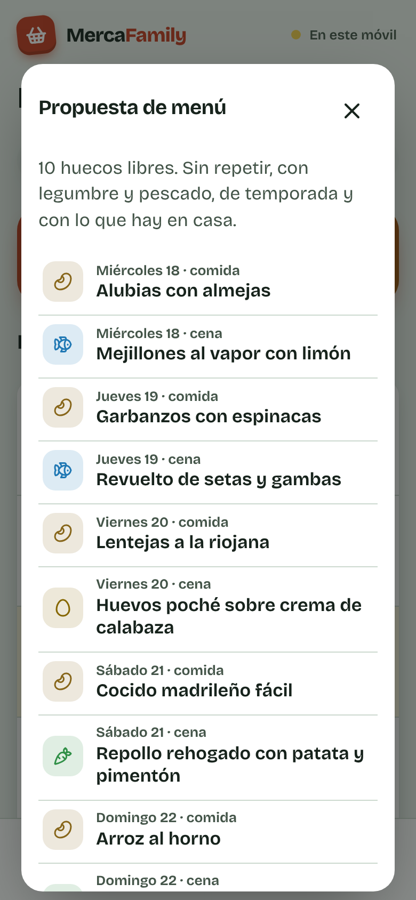
  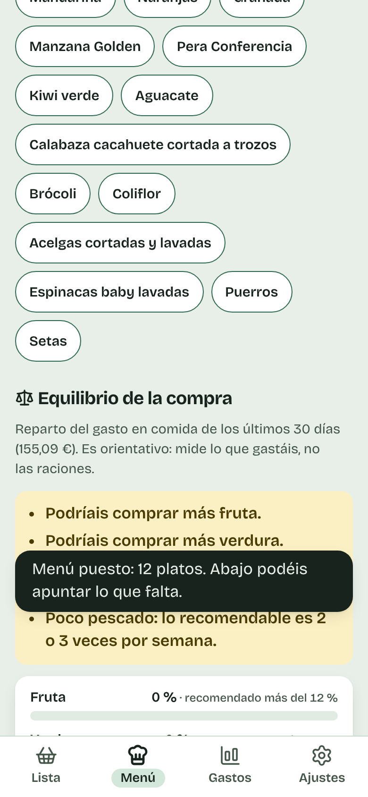
  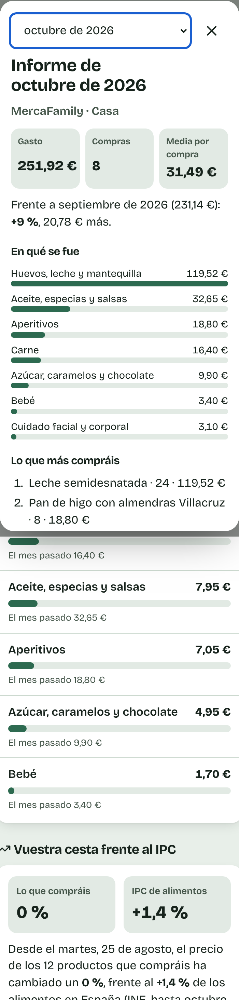
  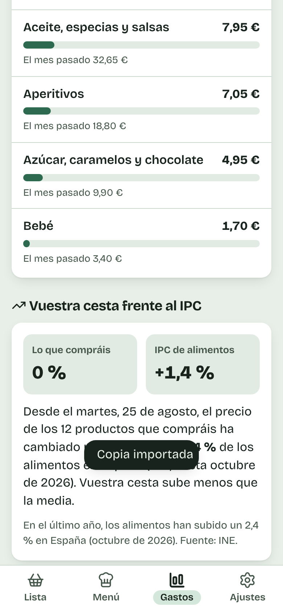
  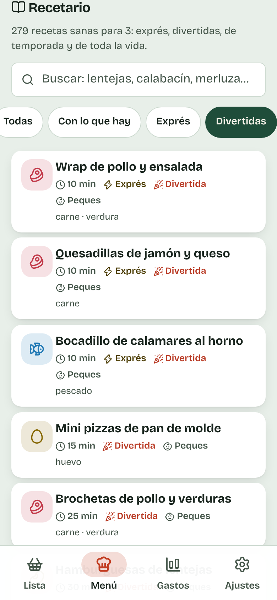
  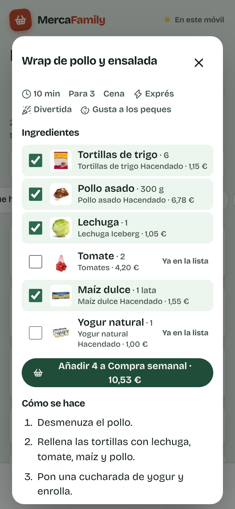
  
</p>

## Qué hace

- **La lista, lo primero.** Al abrir la app se ve la lista y el buscador. Tocar un resultado abre su ficha (precio, otras tiendas, qué lleva) para apuntarlo con la cantidad. Lo que ayuda a decidir (qué coméis hoy, lo que toca comprar, favoritos) va debajo de la lista.
- **Apuntar sin pensar.** Escribes 'leche' o '2 tomates' y aparecen los productos de Mercadona con foto, formato y precio según escribes: todos los que encajan en una lista que se desliza (64 galletas, 62 aguas…), aunque escribáis las palabras juntas ('cocacola'). Al pulsar '+' elige solo el que encaja con vuestras preferencias y con lo que soléis comprar.
- **Varias listas compartidas** ('Compra semanal', 'Al volver del trabajo', 'Cumpleaños'), cada una con icono, color, sus pendientes, su total y su carro. Lo que apunta uno aparece al momento en el móvil de los demás.
- **Modo tienda**: pantalla que no se apaga, letra grande, productos en el orden de los pasillos de vuestro Mercadona (se aprende del orden en que vais marcando), 'No había' con un toque y barra de progreso.
- **En directo entre los dos**: 'Ana ha cogido la leche', 'Luis ha apuntado pan', con el color de cada persona.
- **No había**: lo que falta se queda en la lista para la próxima vez y, si se repite, se marca como 'suele faltar'.
- **Favoritos** con foto para añadir con un toque (la estrella de la ficha).
- **Ficha al tocar el producto** y búsqueda que aprende vuestras palabras ('dinosaurus' → las galletas que elegisteis).
- **Tema claro, oscuro o el del móvil y tres tamaños de letra**, en Ajustes, Pantalla.
- **Prepárame la lista**: con un botón junta lo que falta para el menú, lo que se acaba en casa y lo que toca por frecuencia, todo marcado para quitar lo que sobre.
- **La despensa se corrige sola**: se estima con lo que compráis y la app pregunta poco y fácil. Arriba de la lista, '¿Os queda…?' con tres cosas que según la cuenta se acaban ('Sí' o 'Se acabó', que la apunta). Al añadir una receta, lo que dejáis sin marcar se puede guardar como 'lo tenemos' con un toque. El resumen del domingo lo recuerda.
- **Hoy coméis…**: arriba de la lista sale lo que toca hoy (o la cena de hoy y la comida de mañana por la tarde). Si el hueco está vacío propone un plato con 'Vale' y 'Otra', avisa de lo que falta para hacerlo con 'Apuntar lo que falta', recuerda qué sacar del congelador para mañana y de viernes a domingo ofrece preparar el menú de la semana siguiente.
- **Recetario** con unas 280 recetas sencillas y saludables de cocina de casa para 3: exprés de 5 o 10 minutos, divertidas para peques (mini pizzas, sushi de tortilla, brochetas, polos de yogur…), de primavera, verano, otoño e invierno, sin cocinar, meriendas y de toda la vida (legumbre, pescado, verdura, huevo, arroz, pasta y algo de carne), con cantidades, pasos y tiempo. Las cantidades se recalculan para los que seáis ('Comemos en casa: 5' en Ajustes, o solo esa vez en la receta si hay invitados) y se apuntan los envases que hacen falta. Se busca y filtra (con lo que hay en casa, exprés, divertidas, de temporada, os gustan, comidas, cenas, para peques, sin cocinar, meriendas…). Cada receta se puede marcar con 'Nos gusta' (sale más en las propuestas), 'Ahora no' (se aparta 3 semanas y vuelve sola) o 'No nos gusta' (sale mucho menos, pero nunca desaparece). Todo se deshace con un toque y las marcadas se ven en el filtro 'Apartadas'. Al abrir una receta, un toque añade sus ingredientes a la lista con productos de Mercadona (desmarca lo que ya hay en casa, lo que ya está en la lista y los básicos como sal o aceite) o la pone en el menú de un día.
- **Menú de la semana con comidas y cenas**: 'Propón el menú de la semana' rellena los huecos sin repetir, con legumbre y pescado, de temporada, cenas ligeras y rápidas entre semana, lo que os gusta y aprovechando la despensa, con el coste aproximado de lo que falta. 'Aceptar y apuntar los que faltan' pone el menú y la lista de una vez. Usa todo el recetario y también vuestras recetas guardadas. La app apunta los ingredientes que faltan con vuestras preferencias.
- **De temporada**: la fruta y verdura de cada mes sale marcada en el buscador y en la lista, y en Menú hay una sección para apuntarla con un toque.
- **Equilibrio de la compra**: reparto del gasto en fruta, verdura, legumbre, pescado, carne, procesados y dulces de los últimos 30 días, con consejos sencillos (orientativo).
- **Despensa sin rellenar nada**: se calcula con lo que compráis y cada cuánto, con 'se acaba pronto' y botones de 'Se acabó' o 'Aún queda' para corregirla.
- **Móvil de un peque**: lo que apunta llega como petición y un adulto la acepta o no. Para salir del modo hay que resolver una multiplicación.
- **Dietas y alergias por persona**: aviso al apuntar algo que lleve lo que alguien no puede tomar, según ingredientes y alérgenos de Mercadona.
- **Cambios más sanos** en la lista (mismo tipo de producto, Nutri-Score mejor y precio parecido) y **nota de salud de la cesta** en Gastos.
- **Objetivos por categoría** ('dulces, 40 € al mes') con barra frente al objetivo y comparación con el mes pasado, y **gasto por persona**.
- **Subidas de precio con alternativa**: en Gastos, cada subida trae al lado la opción más barata por kilo, y en la lista sale 'Ha subido un 8 %'.
- **Ahorro conseguido** al aceptar alternativas más baratas.
- **Historial de cada producto** en su ficha: cuántas veces lo compráis y cómo ha ido su precio.
- **Ticket al terminar la compra**, que se imprime con el total y un sello si la semana va por debajo del presupuesto.
- **Guía de bienvenida** de cuatro pasos (y en Ajustes, Ayuda, para verla otra vez).
- **Subir un ticket con foto**: en Gastos o desde la lista. Funciona con tickets largos (varias fotos de arriba abajo, sin repetir líneas) y en catalán. Cada línea se une con su producto de Mercadona, por el precio exacto si se lee y si no por el nombre. Lo dudoso sale arriba para revisarlo con un toque y la compra queda en Gastos. Las fotos se leen en el propio móvil y no se guardan.
- **Apuntar hablando**: el micrófono entiende 'añade leche, dos de tomate y pan de molde' y abre una revisión con cada cosa, su cantidad, el producto propuesto y los demás formatos y tamaños para elegir. No se apunta nada hasta confirmar.
- **Ticket con foto**: al terminar la compra, una foto del ticket de papel rellena el total y guarda los precios reales de cada producto (el lector se descarga solo la primera vez).
- **Avisos en el móvil** ([docs/avisos.md](docs/avisos.md)): cuando alguien apunta algo o termina la compra, si os pasáis del presupuesto, el resumen del domingo y un aviso al salir del trabajo si la lista tiene algo. Cada persona elige los suyos.
- **Formatos**: si otro tamaño del mismo producto sale más barato por kilo o litro ('en garrafa sale un 7 % más barato'), lo dice en la lista y en la ficha, con un botón para cambiar.
- **Voy yo al súper**: un botón que avisa a los demás (en la app y al móvil) para que apunten lo último antes de que llegues.
- **Comparar con Dia y Consum**: en Gastos, lo que más compráis por kilo o litro frente a Dia y Consum, en cada ficha 'En otras tiendas', y al terminar cada compra (y en su detalle en Gastos) lo que os habría costado en Dia y en Consum, contando solo los productos comparables. Carrefour, Eroski y Caprabo bloquean las consultas automáticas y Alcampo no tiene buscador público, así que no se comparan.
- **Panel de estado** en Ajustes: conexión, cambios pendientes, catálogo, actualización automática, avisos, versión y últimos errores.
- **Informe del mes** en Gastos: gasto y comparación con el mes anterior, categorías, quién compró, lo que más compráis, subidas de precio, ahorro, inflación y consejos. Se guarda en PDF o se comparte, y el día 1 llega un aviso para verlo.
- **Vuestra cesta frente al IPC**: cuánto ha subido lo que compráis vosotros desde vuestras primeras compras frente al IPC de alimentos del INE en los mismos meses.
- **Escáner de código de barras** (Android): apuntas al envase vacío y se añade solo.
- **Preferencias de la familia.** Frases como 'leche semidesnatada sin lactosa' o 'evitar aceite de palma' deciden qué producto se elige.
- **Total previsto** con precios de vuestra zona, en una tira fija abajo, y aviso si os pasáis del presupuesto semanal.
- **Lista por pasillos** con las categorías de Mercadona y un carro para lo que ya habéis cogido.
- **Gastos** por semana, mes y categoría, con cada compra guardada y su detalle.
- **Toca comprar:** 'compráis huevos cada 8 días y hace 9', con un botón para añadirlo todo.
- **Cambios de precio** en lo que compráis, a partir del historial semanal.
- **Ficha de cada producto:** ingredientes, alérgenos, Nutri-Score y valores por 100 g, alternativas más baratas por kilo o litro, más sanas y lo que soléis comprar junto.
- **Funciona sin cobertura de verdad**: lo que apuntáis o marcáis sin señal se guarda en el móvil y se envía en orden al volver la conexión (arriba pone 'Sin conexión · 2 cambios pendientes'). La app abre aunque no haya red, con lo último que tenía. Se instala en el móvil como una app.
- **Accesible:** navegación con teclado y lector de pantalla, contraste AA, botones de 48 px y textos claros.

## Cómo funciona por dentro

| Pieza | Qué hace |
|---|---|
| GitHub Pages | Aloja la app (gratis). |
| GitHub Actions | Cada lunes descarga el catálogo de Mercadona (unos 4.400 productos), completa fichas, guarda el historial de precios y publica. |
| Supabase | Base de datos con tiempo real y acceso con email y contraseña. Guía: [docs/supabase.md](docs/supabase.md). |
| Función de avisos | Función de Supabase que envía los avisos push, llamada por la base de datos (pg_net y pg_cron). [docs/avisos.md](docs/avisos.md). |
| Open Food Facts | Nutri-Score y nutrición por código de barras, consultado desde la app. |
| INE | IPC de alimentos y bebidas no alcohólicas (serie IPC290755), descargado cada lunes a `public/data/ipc.json`. |

### Variables de GitHub (Settings, Secrets and variables, Actions, Variables)

| Variable | Para qué |
|---|---|
| `MERCADONA_CP` | Código postal de casa: decide el almacén y por tanto los precios. Sin ella se mantiene el almacén del último catálogo. Si os mudáis, se crea o se cambia aquí. |
| `SUPABASE_URL` | Dirección del proyecto de Supabase. |
| `SUPABASE_ANON_KEY` | Clave pública de Supabase. |

## Desarrollo

```bash
npm install
npm run dev
npm test
npm run build
node scripts/fetch-mercadona.mjs   # catálogo y precios (MERCADONA_CP opcional)
node scripts/fetch-details.mjs     # fichas pendientes (MAX=1500 por defecto)
```

## Fuentes de datos

- Catálogo público de la tienda online de Mercadona, consultado una vez por semana y solo para uso doméstico. Mercadona no tiene API oficial.
- [Open Food Facts](https://world.openfoodfacts.org/), base de datos abierta de alimentos (licencia ODbL).

## Diseño, accesibilidad y auditoría

- **Dirección:** modo 'Operate' de Impeccable (herramienta de uso diario). Mundo de mercado y ticket: suelo verde hoja pálido con tarjetas blancas y un color por familia de producto (huerta, mar, carne, horno, leche, dulce, limpieza…), con su icono, en la lista, las recetas y las pestañas, para que no todo sea verde. Marca con cesta tomate, limón para lo que toca comprar y 'Hoy coméis', tomate para alertas.
- **Movimiento con criterio:** las pestañas entran deslizándose hacia el lado al que vas, el indicador de la barra de abajo se mueve con el color de cada pestaña, los productos nuevos entran desde arriba, la casilla rebota al marcar (con una vibración corta), el total cuenta hasta su valor, los grupos y recetas aparecen escalonados y sale confeti al coger lo último de la lista. Con 'reducir movimiento' en el móvil no se mueve nada.
- **Estructura limpia:** en Lista, el título es la propia lista (se toca para cambiar o crear otra) y el buscador va justo debajo. Menú se divide en Semana, Recetas y Despensa, con comida y cena de cada día en dos columnas. Ajustes son grupos plegables con icono y el valor actual a la vista (tema, presupuesto, avisos…), para no recorrer quince tarjetas.
- **Letra grande:** probada con la letra del móvil al 135 %. La barra de añadir es una sola línea con micro y escáner dentro, las acciones rápidas van en una fila que se desliza y los huecos de abajo crecen con la letra para que el total y las pestañas no tapen nada. El total previsto vive en una tira de ticket con borde troquelado, fija sobre las pestañas. Tipografía Bricolage Grotesque autoalojada, cifras tabulares e iconos Lucide.
- **Escena de uso:** el pasillo del súper con una mano libre. Botones de 48 px, buscador fijo arriba, lista por pasillos y fotos de producto en caché para cuando no hay cobertura. Tema oscuro automático.
- **Accesibilidad (WCAG 2.2 AA):** enlace 'Saltar al contenido', un `h1` por pantalla y `h2` por sección, buscador con patrón combobox (flechas, Intro y Esc), casillas reales, hojas con `<dialog>` nativo (foco atrapado, Esc y foco devuelto), avisos con `aria-live`, gráfica con tabla de datos equivalente, contraste comprobado en claro y oscuro (mínimo 4,5:1) y `prefers-reduced-motion`.
- **SEO y GEO:** `title` y `description` propios, `canonical`, Open Graph con imagen 1200 × 630, JSON-LD (`WebSite`, `WebApplication`, `WebPage`), contenido descriptivo en el HTML servido, `robots.txt`, `sitemap.xml`, `llms.txt`, 404 con `noindex` y manifest con iconos normales y *maskable*.

### Impeccable (v4.9.2, 17 y 18 de noviembre de 2026)

| Pasada | Resultado |
|---|---|
| Rediseño de color y movimiento (18 de noviembre) | 1 hallazgo: borde lateral grueso de color en los grupos. Quitado, el color va en el icono de la familia. Quedan 4 avisos orientativos de easing con rebote: se mantienen a propósito en la casilla, el '+' y la pestaña activa (pequeños, de 0,4 s, y se apagan con 'reducir movimiento'), porque se pidió más sensación de 'wow'. Página renderizada sin hallazgos. Contraste revisado en claro y oscuro en las cuatro pestañas: corregida la lista activa en oscuro. |
| Código fuente | 1 hallazgo (borde grueso en la casilla, era el trazo de la marca dibujada con CSS). Cambiado por el icono de Lucide. |
| Renderizado a 390, 360 y 1280 px (Lista, Gastos, Ajustes, bienvenida) | Antes: fondo crema por reflejo, interlineado de 1,2 y preferencias sin relleno. Después de corregirlo, sin hallazgos. |

### Herramientas WebMCP

| Herramienta | Qué hace | Efectos |
|---|---|---|
| `ver_lista` | Devuelve la lista con cantidades, precios y total previsto | Ninguno |
| `buscar_producto` | Busca en el catálogo de Mercadona teniendo en cuenta las preferencias | Ninguno |
| `anadir_a_la_lista` | Añade un producto por id o texto | Pide confirmación a la persona |
| `ir_a` | Abre Lista, Gastos o Ajustes | Ninguno |

### Pendiente de comprobar con la app publicada

Rich Results Test, PageSpeed con datos reales y el envío del sitemap a Search Console.
