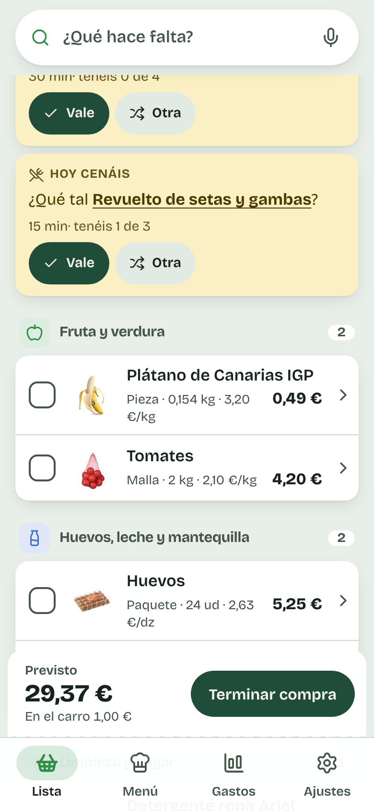
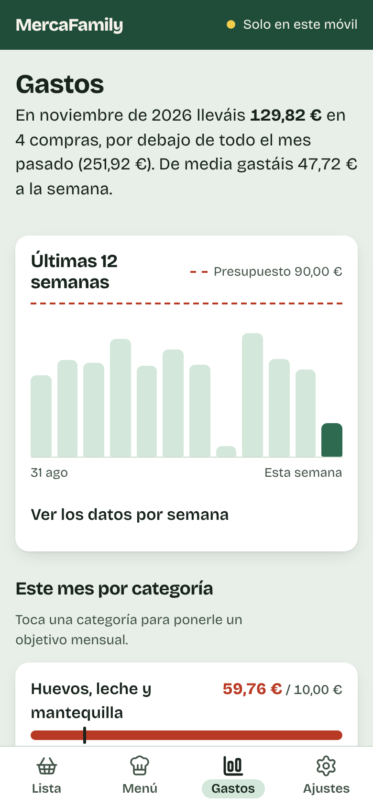
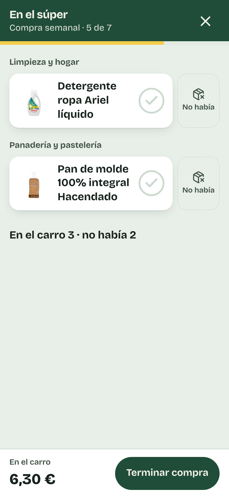
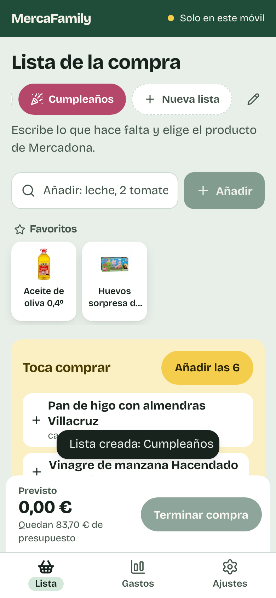
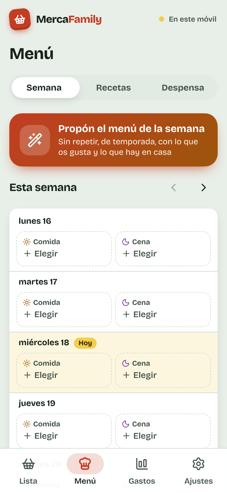
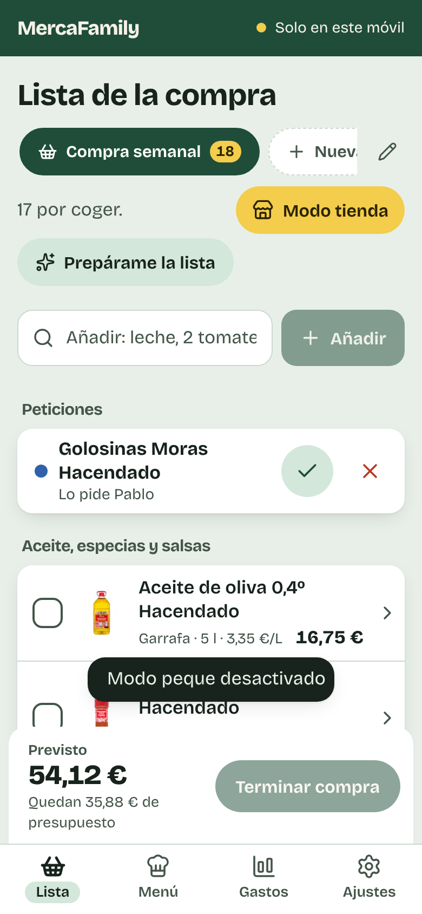
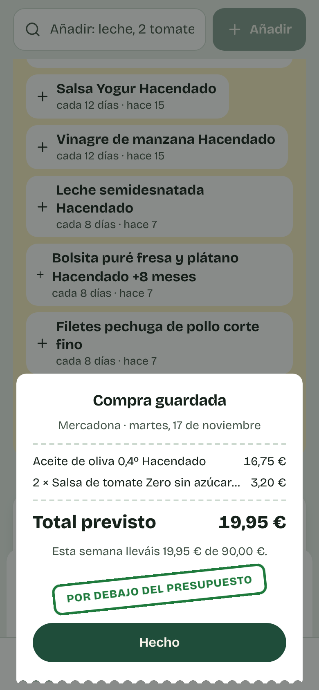
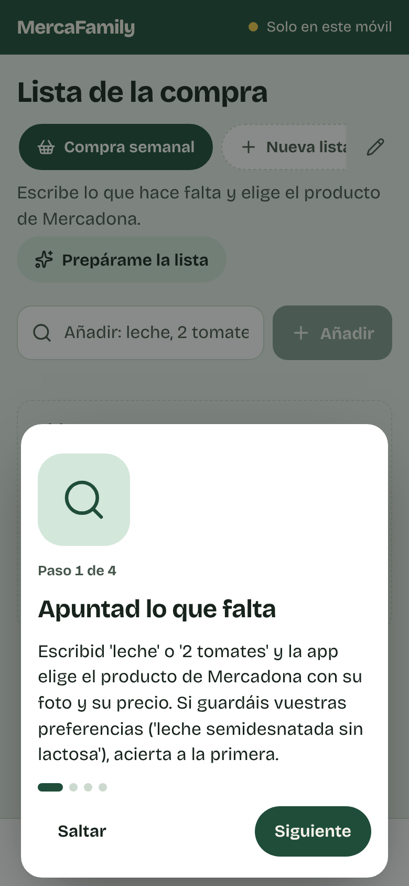
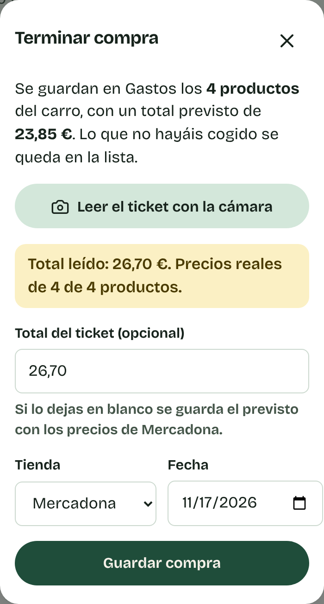

# MercaFamily

Lista de la compra familiar compartida en tiempo real, con el catálogo y los precios de Mercadona actualizados solos cada semana.

**App:** https://carlosdarko.github.io/mercafamily/

<p>
  
  
  
  
  
  
  
  
  
  
  
  
  
  
  
</p>

## Qué hace

- **Apuntar sin pensar.** Escribes 'leche' o '2 tomates' y aparecen los productos de Mercadona con foto, formato y precio según escribes. Al pulsar Añadir elige solo el que encaja con vuestras preferencias y con lo que soléis comprar.
- **Varias listas compartidas** ('Compra semanal', 'Al volver del trabajo', 'Cumpleaños'), cada una con icono, color, sus pendientes, su total y su carro. Lo que apunta uno aparece al momento en el móvil de los demás.
- **Modo tienda**: pantalla que no se apaga, letra grande, productos en el orden de los pasillos de vuestro Mercadona (se aprende del orden en que vais marcando), 'No había' con un toque y barra de progreso.
- **En directo entre los dos**: 'Laura ha cogido la leche', 'Carlos ha apuntado pan', con el color de cada persona.
- **No había**: lo que falta se queda en la lista para la próxima vez y, si se repite, se marca como 'suele faltar'.
- **Favoritos** con foto para añadir con un toque (la estrella de la ficha).
- **Ficha al tocar el producto** y búsqueda que aprende vuestras palabras ('dinosaurus' → las galletas que elegisteis).
- **Tema claro, oscuro o el del móvil y tres tamaños de letra**, en Ajustes, Pantalla.
- **Prepárame la lista**: con un botón junta lo que falta para el menú, lo que se acaba en casa y lo que toca por frecuencia, todo marcado para quitar lo que sobre.
- **Menú de la semana y recetas**: elegís las cenas (hay recetas de partida) y la app apunta los ingredientes que faltan, eligiendo cada producto con vuestras preferencias.
- **Despensa sin rellenar nada**: se calcula con lo que compráis y cada cuánto, con 'se acaba pronto' y botones de 'Se acabó' o 'Aún queda' para corregirla.
- **Móvil de un peque**: lo que apunta llega como petición y un adulto la acepta o no. Para salir del modo hay que resolver una multiplicación.
- **Dietas y alergias por persona**: aviso al apuntar algo que lleve lo que alguien no puede tomar, según ingredientes y alérgenos de Mercadona.
- **Cambios más sanos** en la lista (mismo tipo de producto, Nutri-Score mejor y precio parecido) y **nota de salud de la cesta** en Gastos.
- **Objetivos por categoría** ('dulces, 40 € al mes') con barra frente al objetivo y comparación con el mes pasado, y **gasto por persona**.
- **Subidas de precio con alternativa**: en Gastos, cada subida trae al lado la opción más barata por kilo, y en la lista sale 'Ha subido un 8 %'.
- **Ahorro conseguido** al aceptar alternativas más baratas.
- **Historial de cada producto** en su ficha: cuántas veces lo compráis y cómo ha ido su precio.
- **Ticket al terminar la compra**, que se imprime con el total y un sello si la semana va por debajo del presupuesto.
- **Guía de bienvenida** de cuatro pasos (y en Ajustes, Ayuda, para verla otra vez).
- **Apuntar hablando**: el micrófono entiende 'añade leche, dos de tomate y pan de molde' y apunta cada cosa con su producto.
- **Ticket con foto**: al terminar la compra, una foto del ticket de papel rellena el total y guarda los precios reales de cada producto (el lector se descarga solo la primera vez).
- **Avisos en el móvil** ([docs/avisos.md](docs/avisos.md)): cuando alguien apunta algo o termina la compra, si os pasáis del presupuesto, el resumen del domingo y un aviso al salir del trabajo si la lista tiene algo. Cada persona elige los suyos.
- **Escáner de código de barras** (Android): apuntas al envase vacío y se añade solo.
- **Preferencias de la familia.** Frases como 'leche semidesnatada sin lactosa' o 'evitar aceite de palma' deciden qué producto se elige.
- **Total previsto** con precios de vuestra zona, en una tira fija abajo, y aviso si os pasáis del presupuesto semanal.
- **Lista por pasillos** con las categorías de Mercadona y un carro para lo que ya habéis cogido.
- **Gastos** por semana, mes y categoría, con cada compra guardada y su detalle.
- **Toca comprar:** 'compráis huevos cada 8 días y hace 9', con un botón para añadirlo todo.
- **Cambios de precio** en lo que compráis, a partir del historial semanal.
- **Ficha de cada producto:** ingredientes, alérgenos, Nutri-Score y valores por 100 g, alternativas más baratas por kilo o litro, más sanas y lo que soléis comprar junto.
- **Funciona sin cobertura de verdad**: lo que apuntáis o marcáis sin señal se guarda en el móvil y se envía en orden al volver la conexión (arriba pone 'Sin conexión · 2 cambios pendientes'). La app abre aunque no haya red, con lo último que tenía. Se instala en el móvil como una app.
- **Accesible:** navegación con teclado y lector de pantalla, contraste AA, botones de 48 px y textos claros.

## Cómo funciona por dentro

| Pieza | Qué hace |
|---|---|
| GitHub Pages | Aloja la app (gratis). |
| GitHub Actions | Cada lunes descarga el catálogo de Mercadona (unos 4.400 productos), completa fichas, guarda el historial de precios y publica. |
| Supabase | Base de datos con tiempo real y acceso con email y contraseña. Guía: [docs/supabase.md](docs/supabase.md). |
| Función de avisos | Función de Supabase que envía los avisos push, llamada por la base de datos (pg_net y pg_cron). [docs/avisos.md](docs/avisos.md). |
| Open Food Facts | Nutri-Score y nutrición por código de barras, consultado desde la app. |

### Variables de GitHub (Settings, Secrets and variables, Actions, Variables)

| Variable | Para qué |
|---|---|
| `MERCADONA_CP` | Código postal de casa: decide el almacén y por tanto los precios. Sin ella se mantiene el almacén del último catálogo. Si os mudáis, se crea o se cambia aquí. |
| `SUPABASE_URL` | Dirección del proyecto de Supabase. |
| `SUPABASE_ANON_KEY` | Clave pública de Supabase. |

## Desarrollo

```bash
npm install
npm run dev
npm test
npm run build
node scripts/fetch-mercadona.mjs   # catálogo y precios (MERCADONA_CP opcional)
node scripts/fetch-details.mjs     # fichas pendientes (MAX=1500 por defecto)
```

## Fuentes de datos

- Catálogo público de la tienda online de Mercadona, consultado una vez por semana y solo para uso doméstico. Mercadona no tiene API oficial.
- [Open Food Facts](https://world.openfoodfacts.org/), base de datos abierta de alimentos (licencia ODbL).

## Diseño, accesibilidad y auditoría

- **Dirección:** modo 'Operate' de Impeccable (herramienta de uso diario). Mundo de mercado y ticket: cabecera verde mercado, suelo verde hoja pálido con tarjetas blancas, limón para lo que toca comprar y tomate solo para alertas. El total previsto vive en una tira de ticket con borde troquelado, fija sobre las pestañas. Tipografía Bricolage Grotesque autoalojada, cifras tabulares e iconos Lucide.
- **Escena de uso:** el pasillo del súper con una mano libre. Botones de 48 px, buscador fijo arriba, lista por pasillos y fotos de producto en caché para cuando no hay cobertura. Tema oscuro automático.
- **Accesibilidad (WCAG 2.2 AA):** enlace 'Saltar al contenido', un `h1` por pantalla y `h2` por sección, buscador con patrón combobox (flechas, Intro y Esc), casillas reales, hojas con `<dialog>` nativo (foco atrapado, Esc y foco devuelto), avisos con `aria-live`, gráfica con tabla de datos equivalente, contraste comprobado en claro y oscuro (mínimo 4,5:1) y `prefers-reduced-motion`.
- **SEO y GEO:** `title` y `description` propios, `canonical`, Open Graph con imagen 1200 × 630, JSON-LD (`WebSite`, `WebApplication`, `WebPage`), contenido descriptivo en el HTML servido, `robots.txt`, `sitemap.xml`, `llms.txt`, 404 con `noindex` y manifest con iconos normales y *maskable*.

### Impeccable (v4.9.2, 17 de noviembre de 2026)

| Pasada | Resultado |
|---|---|
| Código fuente | 1 hallazgo (borde grueso en la casilla, era el trazo de la marca dibujada con CSS). Cambiado por el icono de Lucide. |
| Renderizado a 390, 360 y 1280 px (Lista, Gastos, Ajustes, bienvenida) | Antes: fondo crema por reflejo, interlineado de 1,2 y preferencias sin relleno. Después de corregirlo, sin hallazgos. |

### Herramientas WebMCP

| Herramienta | Qué hace | Efectos |
|---|---|---|
| `ver_lista` | Devuelve la lista con cantidades, precios y total previsto | Ninguno |
| `buscar_producto` | Busca en el catálogo de Mercadona teniendo en cuenta las preferencias | Ninguno |
| `anadir_a_la_lista` | Añade un producto por id o texto | Pide confirmación a la persona |
| `ir_a` | Abre Lista, Gastos o Ajustes | Ninguno |

### Pendiente de comprobar con la app publicada

Rich Results Test, PageSpeed con datos reales y el envío del sitemap a Search Console.
